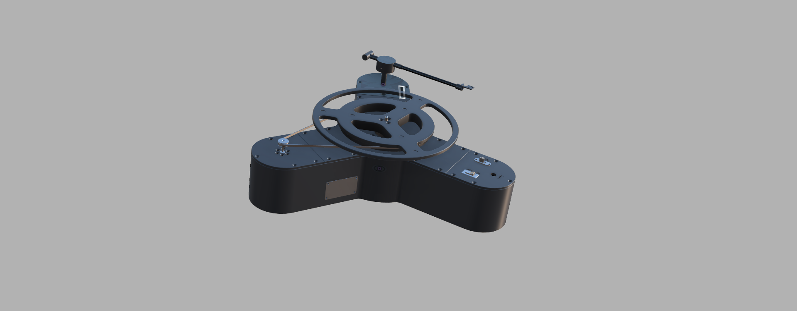
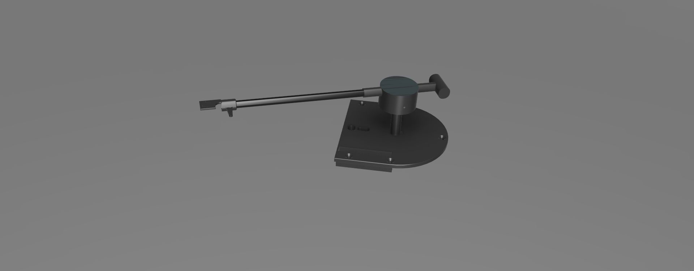
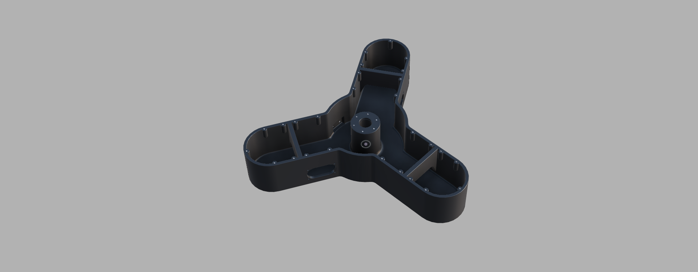
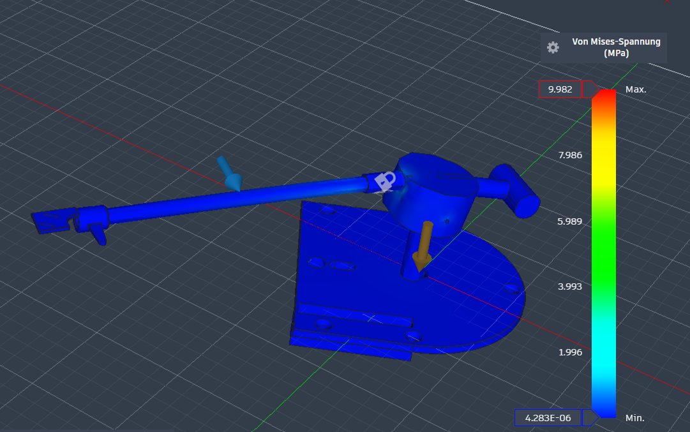
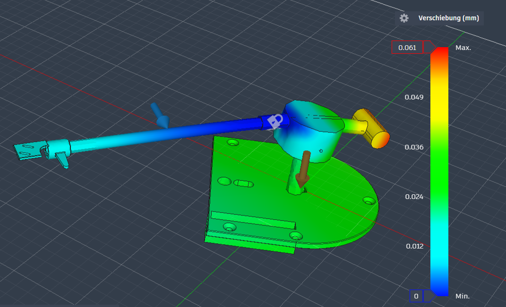
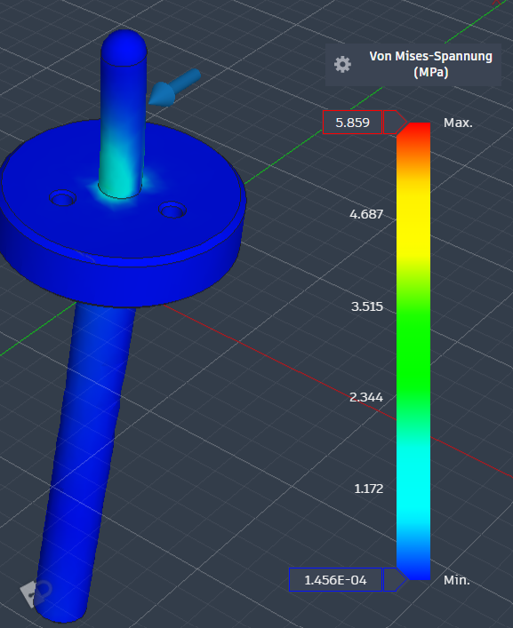

# Schallplattenspieler in Fusion 360

Modul **Virtuelle Produktentwicklung (VPE)** an der Hochschule Darmstadt (April bis September 2026).
Entwicklung und Konstruktion eines Plattenspielers : von der Konzeptdokumentation über den funktionsfähigen Prototyp bis zur FEM-Analyse.




## Projektüberblick

Entwicklung und vollständige Konstruktion eines Schallplattenspielers im Rahmen eines Produktentwicklungsprojekts. Erstellung des 3D-Modells in Fusion 360 unter Berücksichtigung funktionaler, fertigungsgerechter und ästhetischer Anforderungen. Ausarbeitung der technischen Dokumentation inklusive Zeichnungen, Stücklisten und Konstruktionsberichten nach ingenieurwissenschaftlichen Standards. Das Projekt umfasste den gesamten Produktentwicklungsprozess – von der Konzeptphase über die Detailkonstruktion bis zur finalen Dokumentation.
Wichtige Anforderungen waren [z. B. Druckbarkeit, Kosten, Montierbarkeit].

- **Werkzeug:** Autodesk Fusion 360 (CAD, Rendering, FEM-Simulation)
- **Fertigung:** 3D-Druck (PLA) und Normteile, Bauteile aus Edelstahl
- **Umfang:** Stückliste mit 37 Positionen

## Team

Vierköpfiges Team. Meine Aufgaben im Projekt:


| Name | Aufgabe |
|---|---|
| Nick Tedie | Konstruktion des Liftsystems des Tonarm,FEM-Analyse und Dokumentation. |
| Pascal     | Grundkörper des Schallplattenspierlers |
| Houman     | Konstruktion des Tonarm |
| Delano     | Berechnung der Auflagekraft des Tonarms|


## Projektphasen

| Phase | Inhalt |
|---|---|
| Abgabe 1 | Konzeptdokumentation |
| Abgabe 2 | Funktionsfähiger Prototyp, Stückliste (35 Positionen) |
| Abgabe 3 | FEM-Analysen und Präsentation der finale Abgabe |

## Konstruktion

- **Tonarm** (PLA): [Aufgabe des Bauteils, Besonderheit der Konstruktion]
  
   

- **Zentrierdorn** (Edelstahl): zentriert die Schallplatte auf dem Plattenteller


**Grundplatte**(Edelsthal): 


## FEM-Analyse (Fusion 360)

| Bauteil | Werkstoff | σ_max | Verschiebung |
|---|---|---|---|
| Zentrierdorn | Edelstahl | 44,355 MPa |0,016 |
| Tonarm | PLA | 10,119 MPa | 0,063 |

Der Tonarm wurde mit einer vertikale Querkraft F=40mN belastet und an den Tonabnehmer fixiert.
Die maximale Spannung liegt bei 10,119 MPa.



Der DC-Motor (12V, Nenndrehmoment M = 0,2 N·m) treibt den Plattenteller über einen 
Gummiriemen an. Da der Riemen einseitig am Außenrand des Plattentellers angreift, 
entsteht eine radiale Resultante, die als Querkraft auf den Zentrierdorn übertragen wird. 



## Technische Zeichnungen

Fertigungszeichnungen der wichtigsten Bauteile (PDF):

- [Tonarm](drawings/tonarm.pdf)
- [zusammenbau](drawings/zusammenbau.pdf)

## Dokumentation

- [Stückliste (37 Positionen)](docs/stückliste.pdf)
- [Anforderungsliste](docs/anforderungsliste.pdf)
## Repository-Struktur

```
schallplattenspieler/
├── README.md
├── cad/          # CAD-Dateien im neutralen Format (STEP)
├── drawings/     # Technische Zeichnungen (PDF)
├── images/       # Renderings, Fotos, FEM-Screenshots
└── docs/         # Stückliste,  Dokumentation
```

## Hinweise

- Die Konstruktion ist ein Hochschulprojekt und dient zu Lern- und Portfoliozwecken.
- Native Fusion-360-Dateien (`.f3d`) liegen nicht im Repository. Nutze die STEP-Dateien in `cad/`.

## Lizenz

<!-- TODO: Nach Absprache im Team eine Creative-Commons-Lizenz wählen (z. B. CC BY 4.0) und LICENSE-Datei anlegen. -->
Lizenz folgt nach Absprache im Team.


[def]: drawings/tonarm.pdf